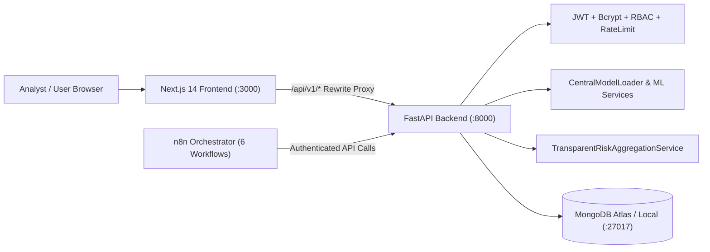
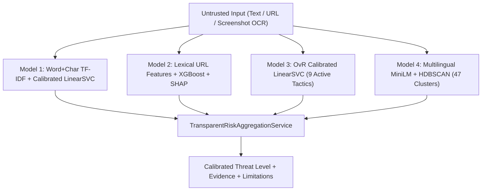
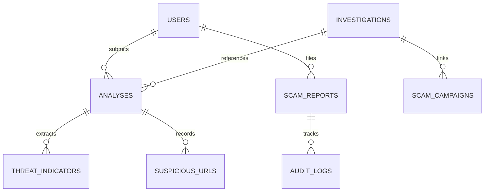
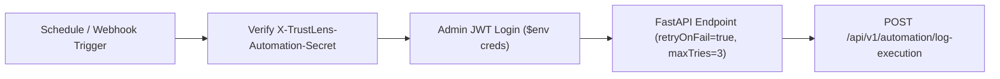
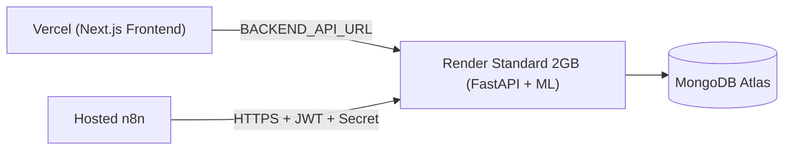

# TRUSTLENS AI

**Multilingual Digital Fraud Intelligence, Threat Investigation Graph & Automated Cyber Triage Platform**

> *"Detect the deception before people lose their money."*

---

## 1. Project Overview

TRUSTLENS AI is a full-stack digital fraud intelligence platform combining four machine learning models (multilingual text scam classification, zero-hop phishing URL detection, social-engineering tactic detection, and HDBSCAN campaign clustering) with a ThreatQ-inspired interactive investigation graph workspace, database-backed SOC analytics, STIX 2.1 / JSON reporting, and n8n workflow orchestration.

## 2. Problem Statement

Digital fraud (smishing, WhatsApp impersonation, UPI/refund traps, and lookalike banking portals) increasingly mixes English, Hindi, and Hinglish lures while rotating short-lived domains. Victims and SOC analysts lack a unified workspace that connects message text, URLs, psychological tactics, and campaign clusters into verifiable, explainable evidence.

## 3. Why Existing Approaches Are Insufficient

- **Binary Blacklists:** Static URL blocklists miss newly registered domains and hyphenated brand-spoofing paths.
- **Opaque Scores:** Single "scam probability" numbers without evidence or provenance cannot be audited by SOC analysts.
- **English-Only Filters:** Standard spam filters underperform on code-mixed Hinglish and regional banking/utility lures.
- **Siloed Tools:** Message scanners, URL checkers, and case graphs rarely share a unified evidence model.

## 4. Proposed Solution

TRUSTLENS AI provides:
1. **Zero-Hop Multi-Modal Analysis:** Analyzes suspicious text, URLs, and OCR-extracted screenshots without visiting remote malicious endpoints.
2. **Transparent Risk Aggregation:** Calibrates signals across models, returning `clean`, `low`, `medium`, `high`, `critical`, or `inconclusive` (never fabricating confidence defaults).
3. **ThreatQ-Inspired Investigation Workspace:** Interactive graph connecting messages, URLs, domains, IPs, tactics, HDBSCAN clusters, and community reports with 1-hop expansion, Object Inspector, and synchronized timeline.
4. **Threat Library, Live Analytics & STIX 2.1 Exports:** Searchable repository across 7 entity types, live MongoDB analytics, and validated JSON / STIX 2.1 exports.

## 5. Target Users

- **SOC Analysts & Cyber Threat Intelligence (CTI) Teams:** Triage alerts, inspect 1-hop indicator relationships, verify community reports, and export STIX 2.1 bundles.
- **Fraud & Trust/Safety Operations:** Monitor emerging smishing/phishing campaign clusters and review tactic distributions.
- **ML & Platform Engineers:** Track model evaluations, SHA-256 artifact checksums, and human-gated model promotions.

## 6. Core Features

- **Analysis Workspaces (`/analyze/text`, `/analyze/url`, `/analyze/image`, `/investigation`):** Dedicated and comprehensive multi-vector inference.
- **ThreatQ Investigation Graph (`/investigations`, `/investigations/[id]`):** Pan/zoom canvas, node selection, 1-hop MongoDB relationship expansion, Object Inspector (`EvidencePanel.tsx`), and multi-track timeline.
- **Threat Library (`/threat-library`):** Search, facet filters, sorting, pagination, provenance/verification badges, and detail modal across 7 stored entity types.
- **Database Analytics (`/analytics`):** Live MongoDB aggregations with date range and source filters.
- **Reporting & Exports (`/reports`):** 5 report types plus JSON (`trustlens-json-v1`) and STIX 2.1 Bundle exports.
- **Model Governance (`/models`):** Registry metadata, SHA-256 checksum verification, and held-out benchmark comparison.

## 7. System Architecture

## 8. ML Architecture

## 9. Dataset Sources & Licensing

Processed corpora are tracked in [`dataset_manifest.json`](file:///c:/Users/jaswant%20karun/TRUSTLENS%20AI/data/processed/dataset_manifest.json) (seed `42`, group-aware splitting):
- **Text Corpus (`StratifiedGroupKFold(n_splits=10)` on `text_group_id`):** `68,716` train / `8,589` val / `8,590` test rows (`English`, `Hindi`, `Hinglish`; threat ratio `0.3629`).
- **URL Corpus (`StratifiedGroupKFold(n_splits=7)` on `domain_group_id`):** `72,051` train / `14,410` val / `14,411` test rows (phishing ratio `0.6294`).
- Raw datasets are preserved unchanged; synthetic test data is excluded from production analytics.

## 10. Data Preprocessing

- Safe chunked loading, deduplication, empty/malformed record filtering, and language tagging (`English`, `Hindi`, `Hinglish`).
- Group-aware splitting (`text_group_id` and `domain_group_id`) prevents near-duplicate text and shared-domain URL leakage across train/val/test splits.

## 11. Training Methods

- **Model 1 (Text):** Compared Word TF-IDF + LogReg, Char TF-IDF + LogReg, Union + LogReg, and Champion **Feature Union (Word+Char) + Calibrated LinearSVC**.
- **Model 2 (URL):** Zero-hop lexical feature extraction (16 features: `path_length`, `https_flag`, `tld_popularity`, `url_entropy`, etc.) trained with **XGBoost** + SHAP explainability.
- **Model 3 (Tactics):** **One-vs-Rest Calibrated LinearSVC** with per-tactic tuned thresholds across 9 supported tactics (`fake_investment` omitted due to missing verified positive ground truth).
- **Model 4 (Campaigns):** Multilingual MiniLM embeddings + **HDBSCAN** density clustering (`47` dossiers).

## 12. Actual Evaluation Results

From [`model_dashboard_data.json`](file:///c:/Users/jaswant%20karun/TRUSTLENS%20AI/ml/artifacts/model_dashboard_data.json) and Phase 5.0 held-out spot checks:
- **Model 1 (Text, `n=8,202`):** Accuracy `0.9777`, Macro F1 `0.9760`, ROC-AUC `0.9960`, FPR `0.0168`, FNR `0.0319` *(Hindi recall `0.5455` on `460` samples)*. Phase 5.0 balanced sample (`n=300`): `1.0000` accuracy (`0` FP, `0` FN).
- **Model 2 (URL, `n=15,131`):** XGBoost Accuracy `0.9998`, F1 `0.9998`, ROC-AUC `1.0000`. On Phase 5.0 `urls_test.parquet` balanced sample (`n=300`): Accuracy `0.9233`, `FP=23` (`FPR=0.1533`), `FN=0`.
- **Model 3 (Tactics):** Micro F1 `0.9513`, Macro F1 `0.9313`, Hamming Loss `0.0039` across 9 active tactics.
- **Model 4 (Campaigns):** `47` HDBSCAN clusters; Silhouette improvement `+0.2917` over DBSCAN baseline (`0.0292`).

## 13. Backend Architecture

FastAPI (`backend/app/main.py`) with modular routers (`auth`, `analyze`, `analyses`, `campaigns`, `models`, `reports`, `training`, `automation`, `investigations`, `threat_library`, `analytics`, `exports`), `CentralModelLoader` with SHA-256 verification, and OWASP security middleware.

## 14. Frontend Architecture

Next.js 14 App Router (`frontend/app/`) with Tailwind CSS, dark ThreatQ-inspired investigation workspace (`frontend/components/investigation/`), centralized typed API client (`frontend/lib/api.ts`), and `next.config.mjs` API rewrite proxy.

## 15. Database Design

## 16. Automation Architecture (n8n)

Six exported workflows in [`n8n/workflows/`](file:///c:/Users/jaswant%20karun/TRUSTLENS%20AI/n8n/workflows/README.md): Threat Intelligence Ingestion, Analysis Notification (with redaction & dedup), Controlled Training Request, Human-Gated Model Approval, Community Report Review, and Daily Intelligence Report.

## 17. Security and Privacy

- `bcrypt` (`rounds=12`) password hashing, `HS256` JWTs, explicit CORS, OWASP security headers, IP sliding-window rate limiting, Pydantic schema validation, `PIL.Image.verify()` upload checks, zero-hop URL inspection, and raw message redaction in n8n analysis alerts.

## 18. Deployment Instructions

1. **Backend:** `pip install -r requirements.txt` -> `uvicorn backend.app.main:app --host 0.0.0.0 --port $PORT --workers 1` (see [`render.yaml`](file:///c:/Users/jaswant%20karun/TRUSTLENS%20AI/render.yaml); `2 GB` RAM required due to `958.96 MB` ML RSS).
2. **Frontend:** `cd frontend && npm ci && npm run build && npm run start` (see [`vercel.json`](file:///c:/Users/jaswant%20karun/TRUSTLENS%20AI/frontend/vercel.json) and [`production-environment-reference.md`](file:///c:/Users/jaswant%20karun/TRUSTLENS%20AI/docs/production-environment-reference.md)).

## 19. Limitations

- **URL Classifier FPR (`15.33%` on balanced held-out sample):** Benign URLs with complex query strings/TLDs can trigger false positives.
- **Hindi Recall (`0.5455`):** Lower threat recall on Devanagari Hindi vs English (`0.9690`) due to class/language imbalance.
- **Cloud & n8n Local Status:** External Vercel/Render/Atlas/n8n instances are not provisioned in this local environment; `npm audit` reports `2` vulnerabilities (`1` critical, `1` high) in `next@14.2.35`.

## 20. Future Improvements

- Upgrade `next` to resolve `npm audit` advisories and provision `.env` secrets on Render/Vercel.
- Expand verified Hindi/regional-language training data and recalibrate URL classification thresholds.
- Add external object-storage artifact sync for Render startup and live n8n server integration tests.
