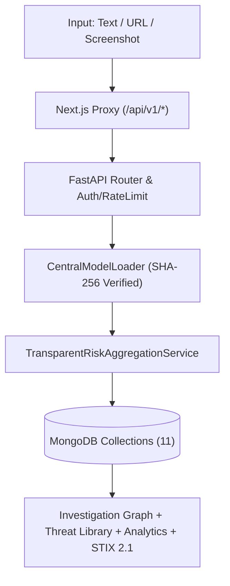

# TRUSTLENS AI — FINAL PROJECT REPORT

> **Submission Date:** November 25, 2026  
> **Repository:** `https://github.com/Jaswant-Karun/TRUSTLENS-AI.git`  
> **Verified Local Production URLs:** `http://localhost:3000` (Frontend), `http://127.0.0.1:8000` (Backend)  
> **External Cloud URLs:** Not provisioned in this environment (`BLOCKED` — see Phase 5.1 Report)

---

## 1. Executive Summary

TRUSTLENS AI is an end-to-end digital fraud intelligence platform built with Next.js 14, FastAPI, MongoDB, scikit-learn/XGBoost/SentenceTransformers, and n8n workflow definitions. Across Phases 1–5, the system was audited, trained on group-split datasets (`text_train/val/test`, `urls_train/val/test`), integrated into a ThreatQ-inspired investigation workspace, and verified against live local production builds.

## 2. Implemented Architecture & Data Flow

- **Investigation Graph Architecture:** Persisted `investigations` (`5` dossiers, e.g., `INV-2026-0011` with `10` nodes) connect `campaign_cluster`, `url`, `domain`, `ip`, `tactic`, `message`, `threat_indicator`, and `user_report` nodes with 1-hop MongoDB relationship expansion.
- **Threat Library & Analytics:** Indexes `248` stored records across 7 entity types and aggregates `152` persisted analyses, `11` suspicious URLs, `4` community reports, `47` HDBSCAN clusters, `8` threat indicators, and `5` investigations.

## 3. Verified Model Results

- **Model 1 (Text — Feature Union + Calibrated LinearSVC):** `97.77%` accuracy, `0.9760` Macro F1, `0.9960` ROC-AUC on `8,202` held-out samples (`0.9690` English recall, `0.5455` Hindi recall).
- **Model 2 (URL — XGBoost + SHAP):** `99.98%` accuracy on benchmark split; `92.33%` accuracy (`23/150` FP, `0/150` FN) on Phase 5.0 balanced `urls_test.parquet` sample (`n=300`).
- **Model 3 (Tactics — OvR Calibrated LinearSVC):** `0.9513` Micro F1, `0.9313` Macro F1 across 9 active tactics (`fake_investment` intentionally marked `UNAVAILABLE` due to lack of ground-truth positives).
- **Model 4 (Campaigns — Multilingual MiniLM + HDBSCAN):** `47` clusters (`+0.2917` Silhouette gain over DBSCAN).

## 4. Known Limitations & Honest Gaps

1. Cloud deployments (Vercel, Render, MongoDB Atlas Cloud, hosted n8n) are **BLOCKED** locally due to absent cloud CLI/credentials.
2. URL classifier showed `15.33%` FPR on balanced held-out sampling; `next@14.2.35` has `2` `npm audit` advisories; root `.env` must be provisioned for production.
