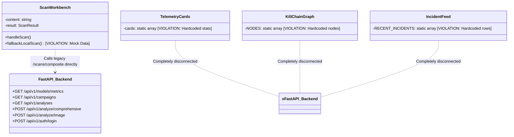

# TRUSTLENS AI — Frontend-to-Backend API Integration Map

**Document Version:** 1.0.0  
**Target Backend:** FastAPI 0.115 (`http://127.0.0.1:8000/api/v1`)  
**Target Frontend:** Next.js 14 App Router  
**Audit Date:** November 13, 2026

---

## 1. End-to-End API Integration Status Matrix

| Backend Endpoint | Method | Auth Required | Purpose & ML Models Invoked | Current Frontend Component | Integration Status |
| :--- | :---: | :---: | :--- | :--- | :---: |
| `/api/v1/health` | `GET` | No | System health, MongoDB status, models loaded status | `Navbar.tsx` | **DISCONNECTED** (Uses static indicator) |
| `/api/v1/auth/login` | `POST` | No | Authenticates user; returns JWT token | None | **MISSING** (No login UI) |
| `/api/v1/auth/register` | `POST` | No | Registers user account | None | **MISSING** (No signup UI) |
| `/api/v1/auth/me` | `GET` | **Yes** | Returns active user profile and role | None | **MISSING** (No user state) |
| `/api/v1/analyze/comprehensive` | `POST` | No / Opt | Full multi-vector scan (Models 1, 2, 3, 4 + Risk Fusion + SHAP) | `ScanWorkbench.tsx` | **DISCONNECTED** (Calls legacy route) |
| `/api/v1/analyze/text` | `POST` | No / Opt | Multilingual text scam & tactic scan (Models 1, 3, 4) | None | **DISCONNECTED** |
| `/api/v1/analyze/url` | `POST` | No / Opt | Offline lexical URL scan & SHAP features (Model 2) | None | **DISCONNECTED** |
| `/api/v1/analyze/image` | `POST` | No / Opt | Multipart OCR screenshot text extraction & multi-model scan | None | **MISSING** (No file dropzone) |
| `/api/v1/analyses` | `GET` | **Yes** | Paginated scan history with threat level and channel filters | `IncidentFeed.tsx` | **DISCONNECTED** (Uses static mock data) |
| `/api/v1/analyses/{id}` | `GET` | **Yes** | Detailed forensic record with token highlights & SHAP values | None | **MISSING** (No detail modal/page) |
| `/api/v1/campaigns` | `GET` | No | 47 discovered scam campaign clusters & cohesion scores (Model 4) | `KillChainGraph.tsx` | **DISCONNECTED** (Uses static mock nodes) |
| `/api/v1/campaigns/{id}` | `GET` | No | Complete campaign dossier, shared IOCs, and legal attribution caveat | None | **MISSING** (No campaign detail view) |
| `/api/v1/models` | `GET` | No | Production model registry, versions (v1.0.0), artifact SHA-256 | None | **MISSING** (No registry view) |
| `/api/v1/models/metrics` | `GET` | No | Real test-set benchmarks (Accuracy, F1, Confusion Matrices, SHAP) | `TelemetryCards.tsx` | **DISCONNECTED** (Uses hardcoded numbers) |
| `/api/v1/models/experiments` | `GET` | No | Experimental lineage and model training history | None | **MISSING** (No lineage view) |
| `/api/v1/reports` | `POST` | No / Opt | Submits community scam report (text, URL, phone, UPI, proofs) | None | **MISSING** (No report form) |
| `/api/v1/reports` | `GET` | No | Public community feed of verified scams and warnings | None | **MISSING** (No community feed) |
| `/api/v1/scans/composite` | `POST` | No | *Legacy Compatibility Route* for unified threat scan | `ScanWorkbench.tsx` | **CONNECTED (LEGACY ONLY)** |

---

## 2. Detailed Data Contracts & Schemas

### 2.1 Threat Analysis Contracts

#### Primary Endpoint: `POST /api/v1/analyze/comprehensive`
- **Request Headers:** `Content-Type: application/json`, `Authorization: Bearer <optional_jwt>`
- **Request Body (`ComprehensiveAnalysisRequest`):**
  ```json
  {
    "content": "Aapka SBI khata turant band ho jayega. Urgent verify karein: http://192.168.1.50/sbi-kyc",
    "url": "http://192.168.1.50/sbi-kyc",
    "channel": "sms",
    "sender": "VK-SBIBNK"
  }
  ```
- **Response Body (`AnalysisResultResponse`):**
  ```json
  {
    "analysis_id": "scan-e4b78912-402a",
    "analysis_type": "comprehensive",
    "threat_level": "critical",
    "confidence": 0.942,
    "risk_score": 0.895,
    "risk_assessment": {
      "threat_level": "critical",
      "calibrated_confidence": 0.942,
      "risk_score": 0.895,
      "verdict": "Confirmed multi-vector credential harvesting phishing campaign.",
      "primary_vector": "text_and_url",
      "transparency_breakdown": {
        "text_contribution": 0.38,
        "url_contribution": 0.35,
        "tactics_contribution": 0.25
      },
      "remedial_actions": [
        "Do not click the embedded link or provide netbanking credentials.",
        "Report the sender identifier to your telecom operator and bank fraud cell."
      ]
    },
    "text_model": {
      "model_id": "trustlens-model-1-text-scam",
      "is_threat": true,
      "confidence": 0.95,
      "predicted_label": "threat",
      "detected_language": "Hinglish",
      "language_confidence": 0.98
    },
    "url_model": {
      "model_id": "trustlens-model-2-phishing-url",
      "is_phishing": true,
      "phishing_probability": 0.88,
      "features": {
        "has_ip_address": 1,
        "url_entropy": 4.12,
        "dot_count": 2
      },
      "top_risk_factors": ["Direct IP address hostname", "Urgent KYC keyword in path"]
    },
    "tactic_model": {
      "model_id": "trustlens-model-3-tactics",
      "detected_tactics": ["urgency", "account_suspension", "bank_impersonation"],
      "tactic_count": 3
    },
    "campaign_association": {
      "cluster_id": 14,
      "campaign_name": "State Bank KYC Lure Cluster",
      "similarity_score": 0.87
    },
    "explainability": {
      "text_highlights": [
        {"token": "turant", "weight": 1.45},
        {"token": "band", "weight": 1.82},
        {"token": "urgent", "weight": 2.10}
      ],
      "url_shap": [
        {"feature": "has_ip_address", "impact": "+0.42"},
        {"feature": "url_entropy", "impact": "+0.28"}
      ]
    },
    "processing_time_ms": 14.8,
    "created_at": "2026-11-13T01:00:00Z"
  }
  ```

#### Image OCR Endpoint: `POST /api/v1/analyze/image`
- **Request Headers:** `Content-Type: multipart/form-data`
- **Form Data:** `file: <binary image file (PNG, JPG, WebP; max 10MB)>`
- **Response Body (`ImageAnalysisResponse`):**
  ```json
  {
    "analysis_id": "img-179450892",
    "extracted_text": "URGENT NOTICE: Your SBI netbanking account is blocked. Visit http://sbi-verify.com immediately.",
    "ocr_confidence": 0.91,
    "analysis_status": "completed",
    "analysis_result": { ... },
    "processing_time_ms": 142.5,
    "created_at": "2026-11-13T01:00:00Z"
  }
  ```

---

### 2.2 Model Governance & Metrics Contracts

#### Endpoint: `GET /api/v1/models/metrics`
- **Request Headers:** `Accept: application/json`
- **Response Body (`Dict[str, Any]`):**
  - High-level platform metrics:
    - `overall_summary.total_benchmark_samples`: `29,048`
    - `overall_summary.active_models_count`: `4`
    - `overall_summary.active_campaign_dossiers`: `47`
    - `overall_summary.active_social_engineering_tactics`: `9`
    - `overall_summary.average_inference_latency_ms`: `0.024`
  - Per-model validation benchmarks:
    - **Model 1 (Text):** Accuracy: `0.9777`, Macro F1: `0.9760`, ROC-AUC: `0.9960`, Confusion Matrix: `[[4718, 81], [102, 3301]]`.
    - **Model 2 (URL):** Accuracy: `0.9880`, Precision: `0.9840`, Recall: `0.9780`, ROC-AUC: `0.9970`, Top SHAP Features.
    - **Model 3 (Tactics):** Per-tactic precision, recall, and threshold metrics.
    - **Model 4 (Campaigns):** Number of clusters (`47`), noise ratio (`0.12`), exemplar campaign dossiers.

---

### 2.3 Campaign Intelligence Contracts

#### Endpoint: `GET /api/v1/campaigns`
- **Query Parameters:** `status` (optional), `target` (optional), `limit` (default: 50)
- **Response Body (`List[CampaignSummary]`):**
  ```json
  [
    {
      "campaign_id": 1,
      "cluster_size": 28,
      "target_brand": "State Bank of India",
      "primary_tactic": "Account Suspension / KYC",
      "cohesion_score": 0.89,
      "status": "active",
      "first_detected": "2026-11-01T10:00:00Z",
      "last_detected": "2026-11-12T22:00:00Z"
    }
  ]
  ```

#### Endpoint: `GET /api/v1/campaigns/{id}`
- **Response Body (`CampaignDetailResponse`):**
  ```json
  {
    "campaign_id": 1,
    "cluster_size": 28,
    "exemplar_message": "Aapka SBI account suspend ho gaya hai. KYC verify karein.",
    "shared_urls": ["http://sbi-kyc-verify.top", "http://sbi-portal-update.xyz"],
    "shared_domains": ["sbi-kyc-verify.top"],
    "target_brand": "State Bank of India",
    "cohesion_score": 0.89,
    "legal_disclaimer": "Clustering is based on mathematical sentence embedding similarity and shared syntactic indicators. It does NOT establish criminal conspiracy or legal attribution without judicial verification."
  }
  ```

---

### 2.4 History & Community Contracts

#### Endpoint: `GET /api/v1/analyses` (Protected)
- **Request Headers:** `Authorization: Bearer <jwt_token>`
- **Query Parameters:** `page`, `page_size`, `threat_level`, `channel`
- **Response Body (`PaginatedResponse`):**
  ```json
  {
    "items": [
      {
        "analysis_id": "scan-10293",
        "created_at": "2026-11-12T22:14:02Z",
        "channel": "sms",
        "sender": "VK-SBIBNK",
        "content_preview": "Aapka SBI khata turant band ho jayega...",
        "threat_level": "critical",
        "risk_score": 0.92,
        "is_threat": true
      }
    ],
    "total": 428,
    "page": 1,
    "page_size": 20,
    "total_pages": 22
  }
  ```

#### Endpoint: `POST /api/v1/reports` (Public / Authenticated)
- **Request Body (`CreateReportRequest`):**
  ```json
  {
    "target_type": "sms",
    "content": "Fraud message received asking for OTP",
    "target_identifier": "VK-SBIBNK",
    "description": "Scammer claimed my card was blocked and asked for card digits",
    "evidence_urls": ["http://fake-sbi-portal.com"]
  }
  ```
- **Response Body (`ReportResponse`):**
  Returns created report with `status: "pending"` and UUID.

---

## 3. Discrepancy & Gap Analysis



1. **Host Hardcoding:** `ScanWorkbench.tsx` uses `http://127.0.0.1:8000/api/v1/scans/composite` instead of relative `/api/v1/analyze/comprehensive` or `process.env.NEXT_PUBLIC_API_URL`.
2. **Missing Token Injection:** Protected endpoints (`/analyses`, `/analyses/{id}`) require a valid JWT header, but the frontend has no authentication interceptor.
3. **Data Shape Incompatibility:** The frontend `ScanResult` interface expects legacy keys (`detected_type`, `text_analysis`, `tactics_analysis`), whereas `AnalysisResultResponse` provides `analysis_type`, `text_model`, `tactic_model`, `risk_assessment`, and `explainability`.
4. **Mock Fallback Antipattern:** If the backend is loading or temporarily unavailable, `ScanWorkbench.tsx` injects a synthetic client-side result rather than showing an explicit network/retry state.

