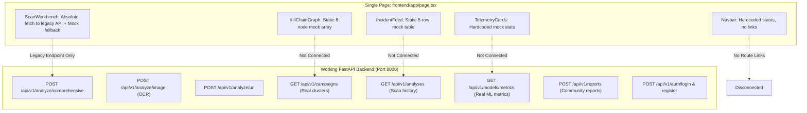

# TRUSTLENS AI — Frontend Architecture & Technical Audit

**Audit Date:** November 13, 2026  
**Auditor:** TRUSTLENS AI Senior Frontend & Security Architect  
**Scope:** Frontend framework, App Router layout, component hierarchy, backend integrations, and anti-fabrication compliance.  
**Strict Rule Compliance:** Read-only audit; zero application code modifications made.

---

## 1. Executive Summary

TRUSTLENS AI features a functional, aesthetically modern dark-mode Security Operations Center (SOC) dashboard built on **Next.js 14 (App Router)** and **Tailwind CSS**. 

However, the current frontend architecture suffers from a fundamental structural flaw: **all platform features are monolithic and co-located on a single entry page (`frontend/app/page.tsx`)**. 

Furthermore, several critical components rely on **hardcoded mock data and client-side synthetic fallbacks** rather than connecting to existing, production-verified FastAPI endpoints and trained ML models.



---

## 2. Frontend Framework & Dependencies Audit

| Property | Value / Specification | Analysis & Notes |
| :--- | :--- | :--- |
| **Framework** | **Next.js 14.2.15** (App Router) | Modern React Server/Client Components support (`app/` directory). |
| **Runtime / Library** | **React 18.3.1**, React DOM 18.3.1 | Standard concurrent mode runtime. |
| **Language** | **TypeScript 5.6.3** | Strict type-checking configured in `tsconfig.json`. |
| **Styling Engine** | **Tailwind CSS 3.4.14** + PostCSS | Dark mode enabled (`class="dark"`), custom cybersecurity palette. |
| **UI Icons** | **Lucide React 0.453.0** | Comprehensive icon suite (`Shield`, `Activity`, `Flame`, `Network`, etc.). |
| **Animation Engine** | **Framer Motion 11.11.9** | Installed and functional for card hover transitions. |
| **Class Utilities** | `clsx 2.1.1`, `tailwind-merge 2.5.4` | Helper utilities for conditional class combining. |
| **Build Status** | **PASSED (0 Errors)** | `next build` statically compiles `/` and `/_not-found` in 14.2s. |

### Theme Tokens (`tailwind.config.ts`)
- `cyberGreen`: `#00ff88` (Legitimate/Safe/Clean vectors)
- `cyberCyan`: `#00d2ff` (Information/Telemetry/Active vectors)
- `cyberRed`: `#ff3366` (Critical threats/Phishing/Malicious vectors)
- `cyberAmber`: `#ffaa00` (Suspicious/Medium risk vectors)
- `background`: `#090d16` (Deep canvas background)
- `surface`: `#0e131f` (Card secondary backdrop)
- `card`: `#141b2d` (Primary content container)
- `border`: `#1e293b` (Subtle boundary lines)

---

## 3. Structural Root Cause: Why Everything Displays on One Page

1. **Absence of Next.js Sub-Routes:**
   The `frontend/app/` directory currently contains only:
   - `layout.tsx` (Root HTML container)
   - `page.tsx` (The single monolithic dashboard)
   - `globals.css` (Tailwind imports and custom scrollbars)
   There are zero page directories (e.g., no `app/scan/`, `app/campaigns/`, `app/history/`, `app/models/`, `app/reports/`, `app/auth/`).

2. **Monolithic Page Assembly:**
   In `frontend/app/page.tsx`, all components are statically stacked sequentially in a single column:
   ```tsx
   <main className="min-h-screen bg-background">
     <Navbar />
     <div className="max-w-7xl mx-auto px-6 py-8">
       <TelemetryCards />   {/* Section 1 */}
       <ScanWorkbench />    {/* Section 2 */}
       <KillChainGraph />   {/* Section 3 */}
       <IncidentFeed />     {/* Section 4 */}
     </div>
     <footer ... />
   </main>
   ```

3. **Navbar Lacks Routing Controls:**
   `frontend/components/Navbar.tsx` acts purely as a visual brand header. It contains:
   - Logo and title.
   - Hardcoded status pill (`SYSTEM: ACTIVE`).
   - Static backend indicator (`BACKEND: FASTAPI [8000]`).
   - Hardcoded anchor link to `http://127.0.0.1:8000/docs`.
   It provides zero `<Link>` elements to navigate between specialized operational views.

---

## 4. Component-by-Component In-Depth Audit

### 4.1 Component: `Navbar.tsx`
- **Location:** `frontend/components/Navbar.tsx` (58 lines)
- **Role:** Sticky top-level header.
- **Defects Identified:**
  1. **No Application Navigation:** Completely missing navigation tabs (`Overview`, `Live Scanner`, `Campaign Graph`, `Scan History`, `Model Metrics`, `Report Scam`).
  2. **Hardcoded External Docs URL:** Points directly to `http://127.0.0.1:8000/docs`. If accessed in production or over a domain, this link breaks.
  3. **No Dynamic Health Check:** The status indicator (`SYSTEM: ACTIVE`) is a hardcoded static pulse with no polling to `/api/v1/health`.
  4. **No User Profile / Authentication State:** Displays no login button, active user badge, or role-based controls.

### 4.2 Component: `TelemetryCards.tsx`
- **Location:** `frontend/components/TelemetryCards.tsx` (77 lines)
- **Role:** High-level metrics row at the top of the dashboard.
- **Defects Identified:**
  1. **Fabricated Static Statistics (Rule 7 Violation):**
     - Hardcoded `Processed Scans: 42,890`
     - Hardcoded `Blocked Threat Vectors: 14,203`
     - Hardcoded `Coordinated Campaigns: 18 Clusters`
     - Hardcoded `Inference Latency: 18.5 ms`
  2. **Zero API Fetching:** Does not call `GET /api/v1/models/metrics` or `GET /api/v1/telemetry/summary` or `GET /api/v1/analyses`.

### 4.3 Component: `ScanWorkbench.tsx`
- **Location:** `frontend/components/ScanWorkbench.tsx` (230 lines)
- **Role:** Interactive input area for scanning suspicious text and URLs.
- **Defects & Architectural Gaps:**
  1. **Direct Host Coupling:**
     `fetch("http://127.0.0.1:8000/api/v1/scans/composite")` hardcodes the backend host, bypassing the Next.js rewrite in `next.config.mjs` (`/api/v1/:path*`).
  2. **Legacy Route Dependency:**
     Calls `/api/v1/scans/composite` instead of the primary enterprise endpoint `POST /api/v1/analyze/comprehensive`.
  3. **Synthetic Mock Fallback on Error (Rule 7 Violation):**
     `fallbackLocalScan()` fabricates synthetic predictions (`confidence: 0.88`, `overall_threat_level: "high"`) if the network request fails, directly violating the project's anti-fabrication mandate.
  4. **Missing OCR Screenshot Upload:**
     Has no file dropzone, file input, or `multipart/form-data` handler for `POST /api/v1/analyze/image`.
  5. **Missing Standalone URL Inspection:**
     Lacks dedicated UI tabs to toggle between Text, URL, and Image modes.
  6. **Missing Explainability Display:**
     Does not display token-level lexical attributions or SHAP feature importance graphs returned by the backend.

### 4.4 Component: `KillChainGraph.tsx`
- **Location:** `frontend/components/KillChainGraph.tsx` (157 lines)
- **Role:** Visual threat kill-chain diagram.
- **Defects Identified:**
  1. **Completely Hardcoded Mock Array:** Uses static array `NODES` containing 6 hardcoded items (`Attack Origin`, `Deceptive Lure`, `Phishing Landing`, `OTP Interceptor`, `Mule Account`, `Exit Point`).
  2. **Zero Campaign Clustering Connection:** Does not query `GET /api/v1/campaigns` or `GET /api/v1/campaigns/{id}` where 47 real HDBSCAN campaign clusters exist in the backend.
  3. **Missing Legal Attribution Disclaimer:** Model 4 requires a mandatory legal caveat ("Clustering indicates semantic similarity, not legal culpability"), which is absent from this component.

### 4.5 Component: `IncidentFeed.tsx`
- **Location:** `frontend/components/IncidentFeed.tsx` (127 lines)
- **Role:** Live detection table at the bottom of the page.
- **Defects Identified:**
  1. **Static Mock Records:** Displays static array `RECENT_INCIDENTS` containing 5 hardcoded incidents (`VK-SBIBNK`, `203.0.113.15`, `+91 98402 11928`, `billing@hdfc-updates-kyc.top`, `AD-SWIGGY`).
  2. **Disconnected from Database:** Does not fetch actual scan history from `GET /api/v1/analyses` or community submissions from `GET /api/v1/reports`.
  3. **No Filtering or Pagination:** Lacks channel filtering, threat-level filtering, search query input, and pagination controls supported by the backend.

---

## 5. Integration Audit: Frontend to Backend Connection

### 5.1 Base URL & Proxy Rewrites
- **Next.js Rewrite Configuration (`frontend/next.config.mjs`):**
  ```javascript
  async rewrites() {
    return [
      {
        source: "/api/v1/:path*",
        destination: "http://127.0.0.1:8000/api/v1/:path*",
      },
    ];
  }
  ```
- **Discrepancy:** The Next.js rewrite is configured correctly for relative fetches (`/api/v1/...`), but `ScanWorkbench.tsx` bypasses it by executing direct cross-origin fetches to `http://127.0.0.1:8000/api/v1/scans/composite`.

### 5.2 Environment Variables Audit
- **Status:** **CRITICAL DEFICIENCY**
- No `.env`, `.env.local`, or `.env.production` file exists inside `frontend/`.
- No `NEXT_PUBLIC_API_URL` environment variable is defined.

### 5.3 Authentication & Authorization Gap
- The FastAPI backend implements standard OAuth2 / JWT authentication (`POST /api/v1/auth/login`, `POST /api/v1/auth/register`, `GET /api/v1/auth/me`).
- Protected backend routes (such as `GET /api/v1/analyses`) enforce `Depends(get_current_user)`.
- **Current Frontend Status:** The frontend has zero authentication handling:
  - No login or registration modal or page.
  - No token storage (no `localStorage`, `sessionStorage`, or cookies).
  - No HTTP request interceptor to attach `Authorization: Bearer <token>`.
  - Consequently, any direct request to authenticated backend endpoints currently fails with `HTTP 401 Unauthorized`.

---

## 6. Summary of Existing Working Features to Preserve

Under **Rule 6 ("Do not remove existing working features")**, the following design assets and logic must be preserved during reorganization:
1. **Visual Aesthetic & Styling Tokens:** High-contrast cybersecurity theme, dark canvas (`#090d16`), vibrant status badges (`cyberGreen`, `cyberRed`, `cyberAmber`, `cyberCyan`).
2. **Preset Attack Scenarios:** Hinglish SBI KYC, Work-from-Home, and IP Phishing presets.
3. **Multi-Vector Assessment Logic:** Display of overall threat level, confidence, detected language, and triggered tactics.
4. **Interactive Graph UI:** Clickable node inspection card layout in `KillChainGraph.tsx`.
5. **Incident Table Structure:** Tabular schema displaying Time, Vector, Sender, Payload, Classification, Severity, and Action.

