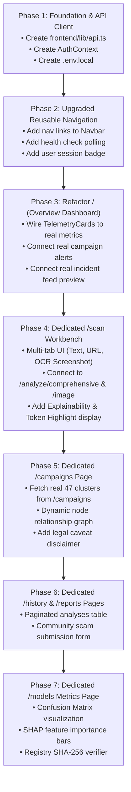

# TRUSTLENS AI — Frontend Architecture Roadmap & Migration Plan

**Document Version:** 1.0.0  
**Status:** Architecture Proposal (Awaiting User Review & Approval)  
**Target Platform:** Next.js 14 App Router, TypeScript, Tailwind CSS, Lucide React, Framer Motion  
**Date:** November 13, 2026

---

## 1. Information Architecture & Target Route Hierarchy

To transform TRUSTLENS AI from a cramped single-page display into a professional, enterprise-grade cybersecurity and fraud intelligence portal, the frontend will be reorganized into a clean multi-page App Router structure:

```
frontend/app/
├── layout.tsx                     # Root layout with global Navbar, AuthProvider, and Footer
├── globals.css                    # Cybersecurity dark-mode CSS tokens
├── page.tsx                       # [Route: /] SOC Intelligence Overview Dashboard
├── scan/
│   └── page.tsx                   # [Route: /scan] Multi-Modal Threat Workbench (Text, URL, OCR)
├── campaigns/
│   └── page.tsx                   # [Route: /campaigns] Threat Intelligence Graph & Cluster Dossiers
├── history/
│   └── page.tsx                   # [Route: /history] Forensic Incident Log & Threat History
├── models/
│   └── page.tsx                   # [Route: /models] Model Governance, Confusion Matrix & SHAP Metrics
├── reports/
│   └── page.tsx                   # [Route: /reports] Community Scam Intelligence & Incident Reporting
└── auth/
    ├── login/
    │   └── page.tsx               # [Route: /auth/login] Analyst & User Login Portal
    └── register/
        └── page.tsx               # [Route: /auth/register] Account Registration
```

---

## 2. Page-by-Page Architectural Specification

### 2.1 `/` — SOC Intelligence Overview Dashboard
- **Purpose:** High-level tactical cockpit for cybersecurity analysts and fraud investigators.
- **Backend Integrations:**
  - `GET /api/v1/models/metrics` -> Populates real telemetry cards (Total Scans, Model Accuracy, Latency, Active Campaigns) with zero fabricated statistics.
  - `GET /api/v1/campaigns?limit=5` -> Shows active threat campaign alert badges.
  - `GET /api/v1/analyses?page_size=5` (or public feed) -> Displays recent 5 detections with direct link to full `/history`.
- **Key Visuals:**
  - Real-time threat distribution breakdown pie/bar chart.
  - System health indicator dynamically polling `GET /api/v1/health`.
  - Quick scanner CTA card linking to `/scan`.

---

### 2.2 `/scan` — Dedicated Multi-Modal Threat Workbench
- **Purpose:** Interactive investigation sandbox for suspicious digital communications.
- **Tabs:**
  1. **Multilingual Text Scanner:** For SMS, WhatsApp forwards, and phishing emails (English, Hindi, Hinglish). Calls `POST /api/v1/analyze/text` or `POST /api/v1/analyze/comprehensive`.
  2. **Zero-Hop Phishing URL Scanner:** Completely offline lexical inspection. Calls `POST /api/v1/analyze/url`.
  3. **Screenshot OCR Inspector:** Drag-and-drop file upload for suspicious payment receipts, bank SMS screenshots, and fake letters. Calls `POST /api/v1/analyze/image`.
- **Verdict & Forensic Breakdown:**
  - Calibrated Risk Gauge (`Clean`, `Low`, `Medium`, `High`, `Critical`).
  - Linguistic Analysis (Detected language, script verification, translation confidence).
  - Multi-Label Social Engineering Tactics triggered with evidence tokens.
  - Explainability Cards: High-weight token highlighting and SHAP feature impact bars.
  - Actionable Remedial Recommendations.
  - **Zero Fabrication Guarantee:** If offline or backend is loading, displays structured loading skeleton or explicit retry error; never injects fake mock data.

---

### 2.3 `/campaigns` — Threat Intelligence Graph & Campaign Clusters
- **Purpose:** Forensic correlation linking isolated fraud incidents into coordinated threat campaigns.
- **Backend Integrations:**
  - `GET /api/v1/campaigns` -> Fetches all 47 real HDBSCAN campaign clusters.
  - `GET /api/v1/campaigns/{id}` -> Fetches complete campaign dossier, shared domains, and exemplar messages.
- **Features:**
  - Cluster list sorted by cohesion score and victim count.
  - Interactive Node Relationship Graph displaying connections between Attack Origin, Lure Pretext, Impersonated Brand, Phishing Domains, and Exit Channels.
  - Clicking a cluster loads its full dossier card.
  - **Mandatory Legal Caveat Banner:** Displays the required disclaimer that similarity clustering reflects mathematical pattern convergence rather than judicial attribution.

---

### 2.4 `/history` — Forensic Incident Log & Scan History
- **Purpose:** Searchable, auditable record of all scans conducted on the platform.
- **Backend Integrations:**
  - `GET /api/v1/analyses` (Paginated, supports `threat_level`, `channel`, `search`).
  - `GET /api/v1/analyses/{id}` (Full forensic detail drilldown).
- **Features:**
  - Filter by Threat Level (`Critical`, `High`, `Medium`, `Clean`).
  - Filter by Channel (`SMS`, `WhatsApp`, `Email`, `URL`, `Screenshot`).
  - Search by sender identifier or keyword.
  - Pagination controls (`Previous`, `Next`, page jump).
  - Row click opens a slide-over drawer with full explainability details.

---

### 2.5 `/models` — Model Governance, Confusion Matrix & SHAP Metrics
- **Purpose:** Transparent, verifiable machine learning evaluation displaying genuine model performance.
- **Backend Integrations:**
  - `GET /api/v1/models` -> Production model registry, versions (v1.0.0), and artifact SHA-256 hashes.
  - `GET /api/v1/models/metrics` -> Held-out test evaluation benchmarks.
  - `GET /api/v1/models/experiments` -> Baseline vs. champion progression history.
- **Features:**
  - **Model 1 (Text):** 97.8% Accuracy, 97.6% F1, Confusion Matrix heatmap ($4718$ TN, $81$ FP, $102$ FN, $3301$ TP), per-language breakdown (English, Hindi, Hinglish).
  - **Model 2 (URL):** 98.8% Accuracy, 0.997 ROC-AUC, 0.998 PR-AUC, interactive SHAP feature importance chart.
  - **Model 3 (Tactics):** Multi-label radar/bar chart for 10 social engineering tactics with optimal decision thresholds.
  - **Model 4 (Campaigns):** Density cluster distribution, noise ratio ($12\%$), and silhouette score.

---

### 2.6 `/reports` — Community Scam Intelligence & Incident Reporting
- **Purpose:** Crowdsourced reporting portal for citizens and analysts.
- **Backend Integrations:**
  - `POST /api/v1/reports` -> Allows submitting suspicious SMS/WhatsApp/UPI scam evidence.
  - `GET /api/v1/reports` -> Lists verified threat warnings and community alerts.
- **Features:**
  - Public submission form with target type (`SMS`, `WhatsApp`, `URL`, `Call`, `UPI`), scammer identifier, and description.
  - Live feed of community-reported active scams.
  - Status badges (`Pending`, `Under Review`, `Verified Scam`).

---

### 2.7 `/auth/login` & `/auth/register` — Analyst & User Authentication
- **Purpose:** Secure JWT authentication and role-based session management.
- **Backend Integrations:**
  - `POST /api/v1/auth/login` -> Authenticates and issues JWT token.
  - `POST /api/v1/auth/register` -> Creates new user account.
  - `GET /api/v1/auth/me` -> Populates user session state.
- **Features:**
  - Clean cybersecurity-themed login card.
  - Stores JWT token in `localStorage` / cookie.
  - Automatically attaches `Authorization: Bearer <token>` to all protected API calls.

---

## 3. Recommended Implementation Sequence

To ensure zero downtime, zero deletion of working features, and strict compliance with all project rules, the rollout will follow a phased sequence:



---

## 4. Files Requiring Modification or Creation

### 4.1 Infrastructure & Utility Files to Create
1. `frontend/.env.local` — API base URL definition (`NEXT_PUBLIC_API_URL=http://127.0.0.1:8000/api/v1`).
2. `frontend/lib/api.ts` — Centralized typed API client handling token injection, error handling, and relative path resolution.
3. `frontend/lib/auth-context.tsx` — React Context managing user authentication, login, logout, and token persistence.

### 4.2 Shared Components to Upgrade
1. `frontend/components/Navbar.tsx` — Add navigation tabs (`Overview`, `Workbench`, `Campaigns`, `History`, `Models`, `Community`), active route highlighting, dynamic health check, and auth controls.
2. `frontend/components/TelemetryCards.tsx` — Replace hardcoded mock stats with dynamic data fetched from `GET /api/v1/models/metrics`.
3. `frontend/components/ScanWorkbench.tsx` — Modernize to support Text, URL, and OCR file dropzone, connecting to `POST /api/v1/analyze/comprehensive` and `POST /api/v1/analyze/image`, removing the mock `fallbackLocalScan`.
4. `frontend/components/KillChainGraph.tsx` — Upgrade to receive real campaign cluster data from `GET /api/v1/campaigns` with mandatory legal attribution disclaimer.
5. `frontend/components/IncidentFeed.tsx` — Upgrade to support pagination and real data from `GET /api/v1/analyses`.

### 4.3 New Route Pages to Create
1. `frontend/app/scan/page.tsx` — Full-screen multi-modal threat investigation workbench.
2. `frontend/app/campaigns/page.tsx` — Campaign intelligence explorer and relationship graph.
3. `frontend/app/history/page.tsx` — Audit log of all past threat analyses with forensic drawer.
4. `frontend/app/models/page.tsx` — ML evaluation dashboard, Confusion Matrix, and SHAP feature viewer.
5. `frontend/app/reports/page.tsx` — Community scam reporting and public warning feed.
6. `frontend/app/auth/login/page.tsx` — User and analyst login portal.
7. `frontend/app/auth/register/page.tsx` — User registration portal.
8. `frontend/app/page.tsx` — Streamline root page to act as the primary SOC Overview Cockpit.

