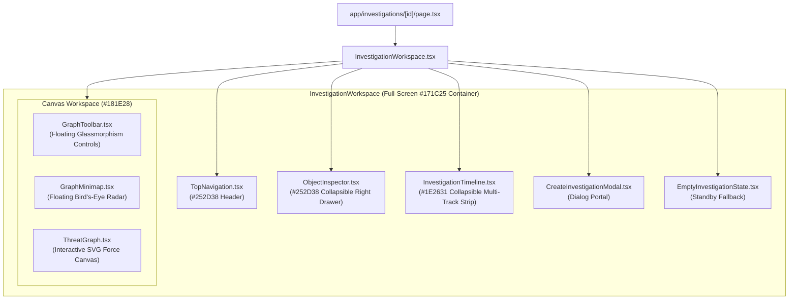

# TRUSTLENS AI — Phase 1 Component Architecture Specification

**Component Tier:** Presentation & Interactive Visualization Layer  
**Framework:** Next.js 14 App Router, React 18, Tailwind CSS, Lucide Icons  
**Reference Model:** ThreatQ Cyber Threat Investigation Interface

---

## 1. Architectural Component Hierarchy



---

## 2. Component Specifications & Interfaces

### A. `TopNavigation.tsx`
- **Location:** `components/investigation/TopNavigation.tsx`
- **Height:** 52px (Fixed)
- **Background:** `#252D38`, border bottom: `#3A4553`
- **Props Interface:**
  ```typescript
  interface TopNavigationProps {
    onCreateClick?: () => void;
    onSearchClick?: () => void;
  }
  ```
- **Key Sub-Elements:**
  - Branding: Hexagonal shield icon with `TRUSTLENS` (white) and `AI` (cyan badge).
  - Navigation Tabs: Home (`/dashboard`), Threat Library (dropdown to `/threat-library`, `/intelligence/tactics`, `/intelligence/campaigns`, `/intelligence/threats`), Investigations (`/investigations`), Analytics (dropdown to `/analytics`, `/models`, `/history`, `/reports`).
  - Active Section Indicator: Glowing cyan underline on active primary route.
  - Utility Controls: `+ Create` primary button, Search button, Notifications popover with live threat counter, Help modal, Settings link, User avatar pill (`RS Senior Analyst`).

---

### B. `ThreatGraph.tsx`
- **Location:** `components/investigation/ThreatGraph.tsx`
- **Canvas:** Full viewport SVG with `#181E28` background and 32px radial dot grid pattern.
- **Props Interface:**
  ```typescript
  interface ThreatGraphProps {
    nodes: GraphNode[];
    edges: GraphEdge[];
    selectedNodeId: string | null;
    selectedEdgeId: string | null;
    onSelectNode: (node: GraphNode | null) => void;
    onSelectEdge: (edge: GraphEdge | null) => void;
    searchQuery?: string;
    typeFilter?: Set<NodeType>;
    zoomLevel?: number;
    onZoomChange?: (zoom: number) => void;
    onViewChange?: (view: { x: number; y: number; zoom: number; bounds: { minX: number; maxX: number; minY: number; maxY: number } }) => void;
  }
  ```
- **Key Capabilities:**
  - **Node Glyphs:** 10 distinct visual styles based on `NodeType` with centered vector icons and circular background fills.
  - **Count Badges:** Top-right counter pill (`radius * 0.7, -radius * 0.7`) displaying indicator counts (e.g. `45` phone numbers).
  - **Selection Propagation:** When a node is selected, its halo illuminates cyan, directly connected edges turn bright blue (`#60A5FA`), and unconnected graph elements dim to $25\%$ opacity.
  - **Dynamic View Centering:** Automatically centers the central cluster hub on container mount.

---

### C. `GraphToolbar.tsx`
- **Location:** `components/investigation/GraphToolbar.tsx`
- **Positioning:** Floating `absolute top-4 left-4 z-30` with backdrop blur and border `#3A4553`.
- **Props Interface:**
  ```typescript
  interface GraphToolbarProps {
    searchQuery: string;
    onSearchChange: (q: string) => void;
    onZoomIn: () => void;
    onZoomOut: () => void;
    onFitScreen: () => void;
    onResetLayout: () => void;
    showMinimap: boolean;
    onToggleMinimap: () => void;
    selectedTypes: Set<NodeType>;
    onToggleType: (type: NodeType) => void;
    syncStatus?: string;
  }
  ```
- **Controls:** Real-time node search input, reset layout, zoom in/out, fit-to-screen, minimap visibility toggle, multi-type filter dropdown, and live intelligence sync status indicator.

---

### D. `GraphMinimap.tsx`
- **Location:** `components/investigation/GraphMinimap.tsx`
- **Dimensions:** 140px × 90px floating `absolute top-14 left-4 z-30`.
- **Props Interface:**
  ```typescript
  interface GraphMinimapProps {
    nodes: GraphNode[];
    viewState: {
      x: number;
      y: number;
      zoom: number;
      bounds: { minX: number; maxX: number; minY: number; maxY: number };
    };
    onClose: () => void;
  }
  ```
- **Functionality:** Projects world coordinates into minimap space, renders node dots with type colors, and overlays a dashed cyan camera viewport rectangle.

---

### E. `ObjectInspector.tsx`
- **Location:** `components/investigation/ObjectInspector.tsx`
- **Width:** 320px (Desktop) / 384px (Large Desktop) collapsible to 40px icon rail.
- **Props Interface:**
  ```typescript
  interface ObjectInspectorProps {
    investigation: InvestigationData;
    selectedNode: GraphNode | null;
    selectedEdge: GraphEdge | null;
    onCloseSelection: () => void;
    onSelectNodeById: (id: string) => void;
    isCollapsed: boolean;
    onToggleCollapse: () => void;
  }
  ```
- **Dual-Mode Rendering:**
  1. **Idle Mode (Investigation Overview):** 3-metric header (`Objects`, `Tasks`, `Comments`), severity badge, creation & modification timestamps with relative times ("10 minutes ago"), collapsible Description, Sources, Tags, and Attributes table.
  2. **Active Mode (Object Forensic Dossier):** Type banner, severity tag, raw content with copy button, ML model output card (model version, calibrated risk score %, SHAP risk factors), and connected neighbor entities with one-click navigation.

---

### F. `InvestigationTimeline.tsx`
- **Location:** `components/investigation/InvestigationTimeline.tsx`
- **Height:** 176px collapsible to 28px summary bar.
- **Props Interface:**
  ```typescript
  interface InvestigationTimelineProps {
    events: TimelineEvent[];
    selectedEventId: string | null;
    onSelectEvent: (event: TimelineEvent | null) => void;
    isCollapsed: boolean;
    onToggleCollapse: () => void;
  }
  ```
- **Multi-Track Structure:**
  - `TASKS` Track: Operational SOC analyst tasks and mitigation steps (blue pills).
  - `SITUATION` Track: Adversary campaign windows and pretext milestones (cyan pills).
  - `SELECTED / IOC` Track: Technical IOC discoveries and detection events (crimson / amber pills).
  - Time Axis: Date guides mapped from `JAN 9` through `MAR 6`.

---

## 3. Data Contracts & State Management

```typescript
// Core Entity Schema
export interface GraphNode {
  id: string;
  label: string;
  type: NodeType;
  subType?: string;
  severity?: "critical" | "high" | "medium" | "low" | "clean";
  count?: number;
  x: number;
  y: number;
  isCentral?: boolean;
  metadata?: {
    description?: string;
    confidence?: number;
    riskScore?: number;
    modelVersion?: string;
    modelOutput?: any;
    evidence?: string[];
    sources?: string[];
    tags?: string[];
    attributes?: Record<string, any>;
    status?: "active" | "mitigated" | "under_review" | "verified";
  };
}

// Edge Schema
export interface GraphEdge {
  id: string;
  source: string;
  target: string;
  label?: string;
  relationship?: string;
  severity?: "critical" | "high" | "medium" | "low" | "neutral";
  isDashed?: boolean;
}

// Timeline Schema
export interface TimelineEvent {
  id: string;
  title: string;
  timestamp: string;
  dateLabel: string;
  track: "tasks" | "situation" | "indicators";
  severity?: "critical" | "high" | "medium" | "low" | "info";
  relatedNodeIds?: string[];
  description?: string;
}
```

---

## 4. State Synchronization Flow

1. **User clicks Timeline Event** $\rightarrow$ `onSelectEvent(event)` fires $\rightarrow$ looks up `relatedNodeIds[0]` $\rightarrow$ triggers `handleSelectNode(targetNode)` $\rightarrow$ centers camera on node and expands `ObjectInspector` with deep forensic details.
2. **User clicks Graph Node** $\rightarrow$ `onSelectNode(node)` fires $\rightarrow$ updates `selectedNode` state $\rightarrow$ inspector switches from Investigation Overview to Object Details $\rightarrow$ `connectedNodeIds` and `connectedEdgeIds` recalculated $\rightarrow$ graph dims unrelated nodes.
3. **User drags Node** $\rightarrow$ `handleMouseMove` computes canvas mouse coordinates divided by zoom factor $\rightarrow$ updates node coordinates in local state without causing full component tree re-mounting.
4. **User toggles Type Filter** $\rightarrow$ `typeFilter.has(type)` updates $\rightarrow$ memoized `visibleNodes` and `visibleEdges` filter immediately, dynamically adapting the graph topology.
