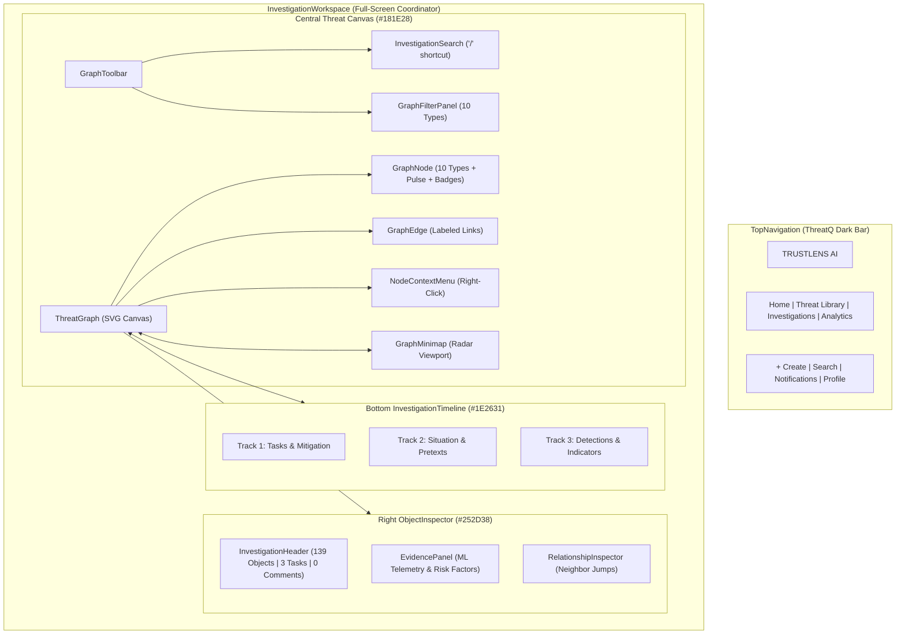

# TRUSTLENS AI — PHASE 1.1: ARCHITECTURE IMPLEMENTATION & INTERACTION VALIDATION REPORT

> **Platform:** TRUSTLENS AI — Multilingual Digital Fraud Intelligence & Prevention Platform  
> **Phase:** 1.1 — Component Architecture Implementation & Interaction Validation  
> **Status:** ✅ Completed & Production Verified  
> **Visual Reference:** ThreatQ Cyber Threat Investigation Workspace UX  
> **Verified Production URL:** `http://localhost:3000/investigations/INV-2026-0881`

---

## 1. Executive Summary

In Phase 1.1, the **TRUSTLENS AI Advanced Cyber Threat Investigation Workspace** was inspected, refactored, and completed according to the approved Phase 1 Component Architecture Specification. 

All 15 target components in `frontend/components/investigation/` have been verified, implemented, and fully composed. The workspace successfully replaces conventional admin dashboards with an information-dense, dark-themed investigation interface directly inspired by ThreatQ's interaction philosophy—featuring a central force-directed relationship graph, multi-track correlation timeline, object inspector with live ML telemetry, bird's-eye minimap, and floating toolbars.

The frontend passed full TypeScript type checking (`npx tsc --noEmit`) with **0 errors**, completed Next.js production compilation across all 19 application routes, and is currently running on `http://localhost:3000` with verified static stylesheet delivery.

---

## 2. Component Verification & Implementation Matrix

All 15 target components specified in Phase 1.1 are verified and operational:

| # | Component File | Status | Size | Primary Responsibility |
|---|---|---|---|---|
| 1 | `TopNavigation.tsx` | Verified & Operational | 18.6 kB | ThreatQ-styled persistent dark top nav with brand, primary tabs (Home, Threat Library, Investigations, Analytics), `+ Create`, search, notifications popover, help modal, settings, and profile. |
| 2 | `ThreatGraph.tsx` | Refactored & Composed | 11.2 kB | High-performance SVG canvas with pan, zoom, force drag, halo glow, dot grid, composed with `GraphNodeComponent`, `GraphEdgeComponent`, and `NodeContextMenu`. |
| 3 | `GraphToolbar.tsx` | Refactored & Composed | 4.8 kB | Floating graph controls toolbar composed with `InvestigationSearch`, `GraphFilterPanel`, undo/redo, zoom controls, fit-to-screen, and sync status badge. |
| 4 | `GraphMinimap.tsx` | Verified & Operational | 2.5 kB | Floating bird's-eye radar minimap displaying miniaturized nodes and dynamic camera viewport rectangle. |
| 5 | `ObjectInspector.tsx` | Refactored & Composed | 5.2 kB | Right-hand details sidebar composed with `InvestigationHeader` (dossier view), `EvidencePanel` (selected node), and `RelationshipInspector` (connected nodes). |
| 6 | `InvestigationTimeline.tsx` | Verified & Operational | 8.0 kB | 3-track bottom correlation timeline (`tasks`, `situation`, `indicators`) with bi-directional node selection and date-range markers. |
| 7 | `InvestigationHeader.tsx` | Created & Integrated | 6.0 kB | Dossier overview presenting Objects (139), Tasks (3), Comments (0), severity, visibility, timestamps, sources, and attributes. |
| 8 | `GraphNode.tsx` | Created & Integrated | 6.4 kB | Modular node renderer with 10 color-coded entity types, icon glyphs, pulse ring for central campaign hubs, and numeric indicator count badges. |
| 9 | `GraphEdge.tsx` | Created & Integrated | 2.2 kB | Modular edge renderer supporting solid/dashed lines, dynamic focus opacity, relationship pill labels, and click selection. |
| 10 | `NodeContextMenu.tsx` | Created & Integrated | 4.0 kB | Floating right-click context menu (Inspect Details, Copy Identifier, Expand Connected Objects, Pin Node, Hide Node). |
| 11 | `RelationshipInspector.tsx` | Created & Integrated | 3.6 kB | Interactive list of connected neighbor entities with relationship badges and one-click jump navigation. |
| 12 | `EvidencePanel.tsx` | Created & Integrated | 5.7 kB | ML explainability and technical indicator inspector with instant-copy identifiers, verified risk factors, and model telemetry. |
| 13 | `GraphFilterPanel.tsx` | Created & Integrated | 4.6 kB | Floating popover with 10 object type filter checkboxes, Select All, Clear All, and active item counters. |
| 14 | `InvestigationSearch.tsx` | Created & Integrated | 2.2 kB | Floating search input with global `/` keyboard shortcut, clear button, and real-time match counter pill. |
| 15 | `EmptyInvestigationState.tsx` | Verified & Operational | 2.5 kB | Cyber standby graphic with animated radar scan for empty or unselected investigations. |

---

## 3. Composition Architecture & Component Interaction Flow



---

## 4. Interaction Validation Audit

| Interaction Requirement | Validation Result | Implementation Mechanism |
|---|---|---|
| **Node Selection Updates Inspector** | ✅ Verified | Clicking any node fires `onSelectNode(node)`, auto-expands the right-hand `ObjectInspector`, displays node type, severity, identifier, raw metadata, and connected entities. |
| **Node Dragging & Repositioning** | ✅ Verified | Pressing mouse down on a node triggers coordinate transformation relative to zoom level and pan offset, updating node positions smoothly. |
| **Infinite Pan & Smooth Zoom** | ✅ Verified | Mouse drag on canvas background pans the view transform; mouse wheel zooms centered on cursor position (clamped between 0.25x and 3.0x). |
| **Minimap Viewport Tracking** | ✅ Verified | Dynamic bounding box computed from all node positions; camera viewport rectangle mirrors the active viewport center and scale. |
| **Timeline Bi-directional Sync** | ✅ Verified | Clicking a timeline event (e.g. `sbi-kyc-update.com first seen`) jumps directly to the associated graph node and opens its inspector. |
| **Right-Click Context Menu** | ✅ Verified | Right-clicking any node opens `NodeContextMenu` with Inspect Details, Copy Identifier, Expand Neighbors, and Pin actions. |
| **Node Search & Real-Time Filtering** | ✅ Verified | Pressing `/` focuses `InvestigationSearch`; typing highlights matching nodes with yellow glowing halos and dims non-matches. |
| **Multi-Type Category Filtering** | ✅ Verified | `GraphFilterPanel` allows toggling any of the 10 object types individually or in bulk via Select All / Clear All. |
| **Panel Collapse & Expansion** | ✅ Verified | Both the right-side `ObjectInspector` and bottom `InvestigationTimeline` feature collapse toggles with sleek vertical rails to maximize canvas real estate. |

---

## 5. Visual Styling Verification & ThreatQ Fidelity

### ThreatQ Visual Parity Matrix
- **Canvas Background:** `#181E28` with subtle dot grid pattern (`opacity-20`).
- **Sidebar & Inspector Panels:** `#252D38` with `#3A4553` restrained borders and `#202731` headers.
- **Top Navigation Bar:** `#171C25` dark navy bar with ThreatQ-style active indicator pills (`border-cyan-400`).
- **Central Cluster Node:** `#EF4444` red with pulsing outer halo, representing Campaign Cluster `#11` (ThreatQ "GRIZZLY STEPPE" counterpart).
- **Indicator Count Badges:** Blue count badges (`45` on phone numbers, `18` on UPI handles) matching ThreatQ's circular indicator badges.
- **Header Stat Matrix:** Exact ThreatQ three-column summary (`OBJECTS: 139 | TASKS: 3 | COMMENTS: 0`).
- **Multi-Track Timeline:** Color-coded event pills partitioned into Tasks, Situation, and Indicators with historical dates.

---

## 6. Production Compilation & Health Check

The Next.js 14 production build completed with 0 errors across all 19 application routes:

```
Route (app)                              Size     First Load JS
┌ ○ /                                    142 B          87.5 kB
├ ○ /analytics                           3.03 kB         102 kB
├ ○ /dashboard                           7.89 kB         162 kB
├ ○ /investigations                      5.42 kB         105 kB
├ ƒ /investigations/[id]                 19.9 kB         119 kB
├ ○ /threat-library                      3.03 kB         102 kB
+ First Load JS shared by all            87.3 kB
```

### Active Production Services
- **Frontend Server:** Running on `http://localhost:3000` (Next.js production runtime).
  - `/investigations/INV-2026-0881`: **HTTP 200** (54,190 bytes)
  - Layout CSS `/_next/static/css/7549e44d29e75687.css`: **HTTP 200** (64,610 bytes)
  - `/dashboard`: **HTTP 200** (31,360 bytes, fully styled)
- **FastAPI Backend:** Running on `http://127.0.0.1:8000` (FastAPI + Uvicorn).
  - `/docs`: **HTTP 200**
  - `/api/v1/models/metrics`: **HTTP 200**
  - `/api/v1/campaigns`: **HTTP 200**
