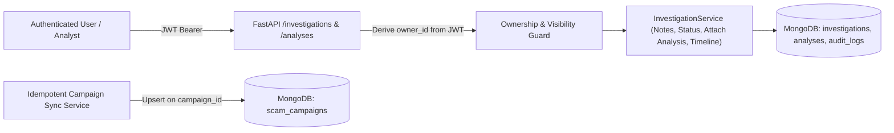

# TRUSTLENS AI — PHASE 2: PRODUCT WORKFLOW POLISH IMPLEMENTATION PLAN

> **Branch:** `remediation/phase-0.5`  
> **Date:** November 25, 2026  
> **Scope:** Planning & Forensic Audit Only — Zero code, schema, or database modifications performed in Phase 2.0.

---

## 1. Current Implementation Findings

- **Auth & RBAC (`backend/app/security/dependencies.py`):** `get_current_user`, `get_optional_current_user`, `require_analyst_or_admin`, and `require_admin` are implemented and verified. `analyses.py` enforces user ownership (`user` sees own `user_id` only; `analyst`/`admin` see all).
- **Investigations (`backend/app/api/routes/investigations.py`, `backend/app/services/investigation_service.py`, `backend/app/schemas/investigation.py`):**
  - 7 endpoints exist (`GET/POST /investigations`, `GET /{id}`, `/graph`, `/timeline`, `/objects/{obj_id}`, `/objects/{obj_id}/relationships`).
  - All 7 endpoints are currently **unauthenticated** (`Public`) and `investigations` documents lack `owner_id` and `notes[]`.
  - No endpoints exist for adding investigation notes, updating investigation status, or attaching an existing `analysis_id` to an investigation.
  - `INV-2026-0011` in MongoDB currently returns `0` timeline events.
- **Analysis History (`frontend/app/history/page.tsx`, `backend/app/api/routes/analyses.py`):**
  - Backend `GET /api/v1/analyses` is properly authenticated and ownership-scoped.
  - Frontend `history/page.tsx` still contains a static `BACKUP_HISTORY` fallback array and lacks an "Attach to Investigation" action.
- **Campaign Dossiers (`ml/artifacts/campaign_detection/campaign_dossiers.json` vs `scam_campaigns`):**
  - `campaign_dossiers.json` contains `47` HDBSCAN clusters (`cluster_id`, `campaign_name`, `sample_count`, `cluster_cohesion_score`, `targeted_institution`, `exemplar_message`, `shared_phrases`, `shared_indicators`, `soc_legal_disclaimer`).
  - MongoDB `scam_campaigns` currently has `0` documents; `campaign_service.py` falls back to reading the JSON file.

---

## 2. Existing Reusable Components

- **Backend:** `get_current_user`, `get_optional_current_user`, `require_analyst_or_admin`, `investigation_service`, `threat_analysis_service`, `campaign_service`, `audit_logs` collection, `InvestigationDetail`, `GraphNodeSchema`, `GraphEdgeSchema`, `TimelineEventSchema`.
- **Frontend:** `lib/api.ts` (`apiFetch` with JWT token support), `InvestigationWorkspace.tsx`, `ObjectInspector.tsx`, `InvestigationTimeline.tsx`, `CreateInvestigationModal.tsx`, `history/page.tsx`.

---

## 3. Identified Defects & Gaps

1. **Missing Authentication & BOLA on Investigations:** Anyone can call `POST /api/v1/investigations` without a JWT; private investigations have no `owner_id` enforcement.
2. **Missing Investigation Notes & Status Update:** Analysts cannot record persistent, attributed notes or transition investigation status (`active -> in_progress -> mitigated -> archived`).
3. **Disconnected Analysis History -> Investigation Flow:** Users cannot attach a saved `analysis_id` from `/history` or `/analyze/*` to an investigation case; `history/page.tsx` has static `BACKUP_HISTORY`.
4. **Incomplete Timeline Generation:** `create_investigation` and mutations do not append structured timeline events (`actor`, `event_type`, `timestamp`, `related_object_ids`). `INV-2026-0011` has `0` persisted timeline events.
5. **Empty `scam_campaigns` Collection:** `47` HDBSCAN dossiers are not persisted in MongoDB `scam_campaigns`, and JSON field names (`cluster_id`, `targeted_institution`, `sample_count`) differ from `indexes.py` (`campaign_id`, `targeted_entity`, `status`).

---

## 4. Proposed Architecture

- **Zero New Databases or Duplicate Services:** All changes extend `InvestigationService`, `CampaignIntelligenceService`, `investigations.py`, `schemas/investigation.py`, and existing frontend pages.

---

## 5. API Contracts (Proposed Additions & Updates)

| Method & Route | Auth / Authz | Request Schema | Response / Behavior |
| :--- | :--- | :--- | :--- |
| `POST /api/v1/investigations` | `get_current_user` | `InvestigationCreate` (ignore any client-sent `owner_id`) | Sets `owner_id = current_user["user_id"]`; appends `creation` timeline event + `audit_logs`; returns `201`. |
| `GET /api/v1/investigations`, `/{id}`, `/graph`, `/timeline`, `/objects/*` | `get_optional_current_user` | — | Returns `"Organization"` / `"Public"` dossiers; enforces `owner_id == user_id` or `analyst`/`admin` for `"Private"` visibility (`403`/`404`). |
| `PATCH /api/v1/investigations/{id}` | `get_current_user` (owner or `analyst`/`admin`) | `{ status?: str, visibility?: str }` | Validates allowed status transitions; updates `updated_at`; appends `status_change` timeline event + `audit_logs`. |
| `POST /api/v1/investigations/{id}/notes` | `get_current_user` (owner or `analyst`/`admin`) | `{ content: str (min 2, max 2000) }` | Derives `author_id` & `author_role` from JWT; appends note + `note_added` timeline event + `audit_logs`. |
| `POST /api/v1/investigations/{id}/attach-analysis` | `get_current_user` (owner of inv AND permitted on analysis) | `{ analysis_id: str }` | Verifies analysis exists & user can access it; rejects duplicate attachment (`409 Conflict`); adds graph node + edge (without mutating `analyses` doc) + timeline event + `audit_logs`. |
| `POST /api/v1/campaigns/sync` | `require_admin` | `{}` | Runs idempotent upsert from `campaign_dossiers.json` into `scam_campaigns`; returns `{ synced, updated, skipped }`. |

---

## 6. MongoDB Schema & Index Changes

- **`investigations` Collection:**
  - Add fields: `owner_id` (string, derived from JWT; `"system"` for baseline seeded dossiers), `notes` (`[{ note_id, author_id, author_role, content, created_at }]`), `attached_analysis_ids` (`List[str]`, deduplication guard).
  - Add index: `{"keys": [("owner_id", 1)]}` in `backend/app/database/indexes.py`.
- **`scam_campaigns` Collection:**
  - Map `campaign_id = cluster_id`, `targeted_entity = targeted_institution`, `cluster_size = sample_count`, `cohesion_score = cluster_cohesion_score`, `status = "active"`, `source_provenance = "ml/artifacts/campaign_detection/campaign_dossiers.json"`, preserving `exemplar_message`, `shared_phrases`, `shared_indicators`, `soc_legal_disclaimer` (no fabricated timestamps).
  - Keep existing unique index `("campaign_id", 1)`.
- **Timeline Recovery for `INV-2026-0011`:**
  - Only recover genuine source events from existing `INV-2026-0011` node `created_at` timestamps and `source` fields (`investigation_service.py` seed logic) if `timeline` is empty—never invent synthetic events.

---

## 7. Security Design

- **Prevent BOLA / IDOR:** Never accept `user_id` or `owner_id` from request bodies; always extract from verified `current_user["user_id"]`.
- **Private Investigation Isolation:** Non-owners (`role == "user"`) attempting to read, note, attach to, or patch another user's `"Private"` investigation receive `403 Forbidden`.
- **Analysis Attachment Authorization:** Attaching an `analysis_id` checks both investigation write access AND `threat_analysis_service.get_analysis_by_id(analysis_id, user_id, role)` so a user cannot leak another user's private analysis into their own investigation.
- **Input & Injection Hardening:** Strict Pydantic `min_length`/`max_length` and `Literal` enums for `status`/`visibility`; parameterized PyMongo queries only (no raw `$where` or user-supplied dicts).
- **Audit Trail:** Every create, note, attach, status update, and campaign sync writes an immutable `audit_logs` entry.

---

## 8. Ordered Implementation Tasks

1. **Task 1 (Schema & Indexes):** Update `backend/app/schemas/investigation.py` (add `NoteCreate`, `InvestigationUpdate`, `AttachAnalysisRequest`, `owner_id`, `notes`) and `backend/app/database/indexes.py` (`owner_id` index).
2. **Task 2 (Investigation Security, Notes, Attach, Timeline):** Update `investigation_service.py` & `routes/investigations.py` with JWT ownership checks, `notes`, `attach-analysis` (409 on duplicate), `PATCH` status, real timeline event recording, and genuine source-node timeline recovery for `INV-2026-0011`.
3. **Task 3 (Idempotent Campaign Sync):** Add `sync_campaigns_from_dossiers()` in `campaign_service.py` + `POST /api/v1/campaigns/sync` (`require_admin`) and run initial sync.
4. **Task 4 (Frontend Integration):** Remove `BACKUP_HISTORY` from `frontend/app/history/page.tsx`, add "Attach to Investigation" modal/action, and add Notes + Status controls to `ObjectInspector.tsx` / `InvestigationHeader.tsx` + typed methods in `frontend/lib/api.ts`.
5. **Task 5 (Verification):** Run unit, integration, negative security, `tsc`, `eslint`, and `next build` tests.

---

## 9. Test Cases

- **Unit & Integration Tests:**
  - `POST /investigations` without JWT -> `401`; with JWT -> `201` with `owner_id == jwt.sub` and `creation` timeline event.
  - `POST /investigations/{id}/notes` -> persists note + `note_added` timeline event + `audit_logs`.
  - `POST /investigations/{id}/attach-analysis` -> adds node/edge + `analysis_attached` timeline event; second call with same `analysis_id` -> `409 Conflict`; original `analyses` record unchanged.
  - `POST /campaigns/sync` -> upserts `47` clusters; second run -> `0` duplicates (`47` total).
- **Negative Security Tests:**
  - User B attempting to view/note/patch User A's `"Private"` investigation -> `403`.
  - User A attempting to attach User B's private `analysis_id` -> `403`/`404`.
  - Client sending `{"owner_id": "admin"}` in `POST /investigations` -> ignored; `owner_id` remains authenticated user.
  - Regular user calling `POST /campaigns/sync` -> `403`.
- **Frontend Tests:** `tsc --noEmit`, `npm run lint`, `npm run build`, unauthenticated `/history` clean state (no `BACKUP_HISTORY`), attach-to-investigation flow.

---

## 10. Acceptance Criteria

- `POST /investigations` requires authentication and derives `owner_id` solely from JWT.
- Private investigations and analyses cannot be accessed or attached across unauthorized users.
- Duplicate analysis attachments return `409` without duplicating graph nodes.
- All timeline events correspond to real persisted actions or recovered node creation timestamps.
- `scam_campaigns` contains `47` idempotently synced dossiers with `source_provenance` preserved.
- Zero regressions across `pytest`, `tsc`, `eslint`, and `next build`.

---

## 11. Risks & Rollback Strategy

- **Risks:** Existing anonymous UI flows on `/investigations` must prompt/redirect for login when creating or mutating an investigation; `INV-2026-0011` timeline recovery must not overwrite user-added events.
- **Rollback Strategy:** Implement on a new branch `feature/phase-2-workflows` branched from `remediation/phase-0.5`; revert via `git checkout remediation/phase-0.5` and `db.scam_campaigns.deleteMany({ source_provenance: "ml/artifacts/campaign_detection/campaign_dossiers.json" })` if needed.
