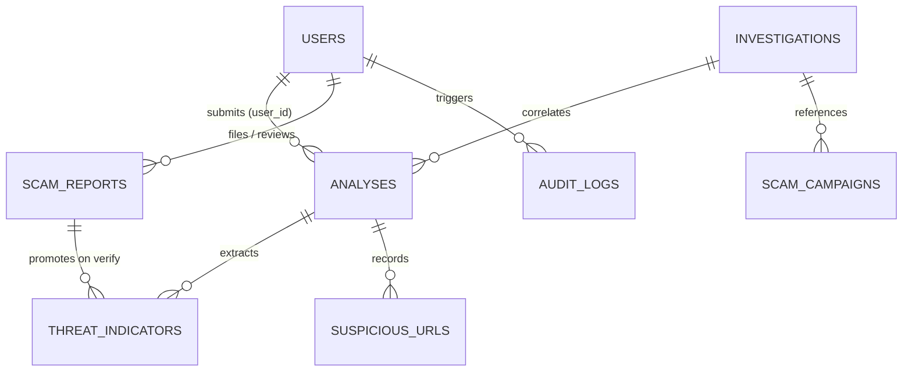

# TRUSTLENS AI — DOMAIN DATA MODEL

> **Grounded in:** `backend/app/database/collections.py` (11 existing MongoDB collections) & `backend/app/database/indexes.py`.

---

## 1. Entity Relationship Diagram

## 2. Collection Mapping & Minimal Additions Needed

| Entity | MongoDB Collection | Key Fields & Indexes | Ownership / Access | Gap / Minimum Evolution |
| :--- | :--- | :--- | :--- | :--- |
| **User** | `users` | `user_id`, `email` (unique), `hashed_password`, `role`, `is_active` | Self / Admin | Add `org_id` only if multi-tenant orgs are enabled |
| **Organization** | *Not yet persisted* | `org_id`, `name`, `settings` | Admin | Optional Phase 2+ collection if multi-org needed |
| **Analysis & Evidence** | `analyses` | `analysis_id` (unique), `user_id`, `analysis_type`, `threat_level`, `risk_score`, `text_model`, `url_model`, `tactic_model`, `extracted_iocs`, `explainability`, `created_at` | Owner (`user`) or `analyst`/`admin` | Already stores embedded evidence & model versions |
| **Investigation & Events** | `investigations` | `investigation_id` (unique), `status`, `severity`, `nodes[]`, `edges[]`, `timeline[]`, `created_at`, `updated_at` | Currently public; add `owner_id` / `visibility` | Add `notes[]` array and enforce auth on mutations |
| **Indicator & URLs** | `threat_indicators`, `suspicious_urls` | `(indicator_type, indicator_value)` unique; `url` unique; `status`, `last_seen` | Public read; analyst/automation write | Index mismatch fixed in Phase 0.5 |
| **CampaignCandidate** | `scam_campaigns` (+ `campaign_dossiers.json`) | `campaign_id` (unique), `cluster_size`, `cohesion_score`, `targeted_entity`, `status` | Public read | Sync 47 dossiers into `scam_campaigns` |
| **CommunityReport & ReviewDecision** | `scam_reports` | `report_id` (unique), `reporter_user_id`, `status`, `reviewed_by`, `review_notes`, `assigned_tactics`, `reviewed_at` | Public submit/list; `analyst`/`admin` review | Embedded `reviewed_by` + `review_notes` avoids extra collection |
| **Notification / Automation** | `automation_logs` | `log_id` (unique), `workflow_name`, `status`, `payload_summary`, `executed_at` | `analyst`/`admin` | Already handles redacted analysis alerts & dedup |
| **AuditEvent** | `audit_logs` | `audit_id` (unique), `user_id`, `action`, `resource_type`, `resource_id`, `timestamp` | `admin` / system | Retain immutable append-only audit trail |
