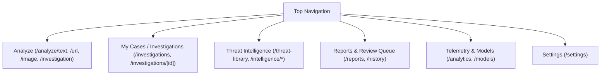

# TRUSTLENS AI — PRODUCT INFORMATION ARCHITECTURE

> **Note:** Conceptual task-oriented IA preserving existing routes; visual design implementation is deferred to the dedicated UI phase.

---

## 1. Coherent Task-Oriented Navigation Model

## 2. How Pages Connect as One Product
- **Analyze (`/analyze/*`, `/investigation`)** feeds persisted `analyses` directly into **History (`/history`)**, **Threat Library (`/threat-library`)**, and **Analytics (`/analytics`)**.
- **Investigations (`/investigations/[id]`)** is the primary workbench where analysts correlate messages, URLs, domains, tactics, HDBSCAN clusters, and verified community reports via 1-hop MongoDB expansion.
- **Reports & Review Queue (`/reports`)** serves both citizen submission and the RBAC-gated (`require_analyst_or_admin`) verification queue plus JSON / STIX 2.1 exports.
- **Settings (`/settings`)** holds user/session and engine configuration without cluttering operational workflows.
