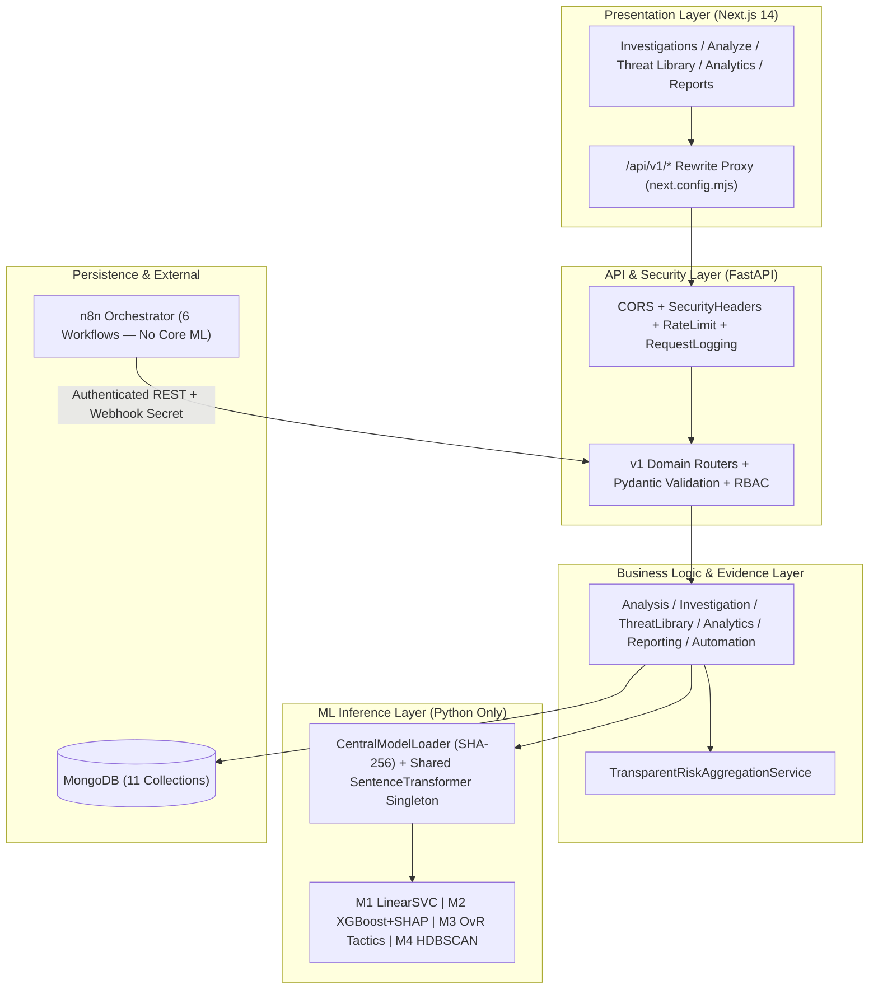

# TRUSTLENS AI — SYSTEM ARCHITECTURE

> **Stack:** Next.js 14 (Vercel) -> FastAPI Python 3.12 (Render Standard 2GB) -> MongoDB Atlas / Local -> Hosted n8n

---

## 1. Layered Architecture & Strict Boundaries

## 2. Boundary Rules
- **n8n Responsibility:** Scheduling, webhook triggers, secret checks, HTTP retries, and routing only. All ML inference, deduplication, and risk scoring remain in Python services.
- **ML Runtime Constraint:** Shared `get_shared_sentence_transformer` singleton (`750.12 MB` RSS) requires Render Standard (`2 GB` RAM); `.joblib`/`.pt` binaries are excluded from Git and require persistent disk or startup object-storage sync.
