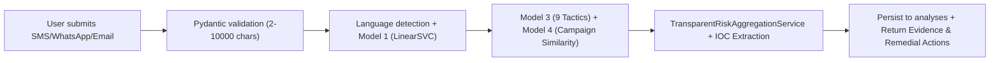

# TRUSTLENS AI — END-TO-END USER JOURNEYS

---

## Workflow A — Suspicious Message Analysis

- **Outcome:** User sees `threat_level`, calibrated `risk_score`, `model_version`, detected tactics, extracted IOCs, and protective actions—clearly labeled as automated ML inference.

## Workflow B — Suspicious URL Analysis (Zero-Hop)
1. User submits URL (`4–2048` chars) via `/analyze/url`.
2. Backend normalizes and extracts 16 lexical features offline (**never** sends HTTP/DNS requests to the target URL).
3. Model 2 (`XGBoost`) + SHAP `TreeExplainer` compute phishing score and top feature attributions.
4. Stored `threat_indicators` / `suspicious_urls` are checked (missing match is never treated as safety).
5. Result is persisted and returned with zero-hop explanation and next steps.

## Workflow C — Screenshot Analysis
1. User uploads JPEG/PNG/WebP (`<= 10 MB`, `> 0 bytes`).
2. `ocr_service.validate_and_read_image` verifies MIME type, byte size, and `PIL.Image.verify()`.
3. Local `pytesseract` OCR extracts text. If unreadable/blank, returns `analysis_status: "insufficient-evidence"` without fabricating a prediction.
4. If readable text exists, runs Workflow A (`channel="screenshot"`) and returns OCR text + confidence + ML assessment + OCR limitations.

## Workflow D — Investigation Management
1. Analyst opens `/investigations` and selects or creates an investigation (`POST /api/v1/investigations`).
2. Graph (`GET /investigations/{id}/graph`) and Timeline (`GET /investigations/{id}/timeline`) load persisted MongoDB nodes, edges, and events.
3. Analyst selects a node to inspect provenance/evidence (`ObjectInspector`) and triggers 1-hop relationship expansion (`GET .../relationships`) to discover matching stored IOCs/analyses.
4. Analyst exports findings as JSON or STIX 2.1 (`GET /exports/json`, `/exports/stix`).

## Workflow E — Community Reporting & Human Review
1. User submits suspicious target + content (`POST /api/v1/reports`, initial status `pending`).
2. Authorized reviewer (`analyst`/`admin`) opens `/reports`, inspects evidence, assigns tactics, and commits verdict (`verified_scam | under_review | benign`) via `POST /api/v1/reports/{id}/review`.
3. Backend records reviewer ID, timestamp, `audit_logs` entry, and extracts verified indicators into `threat_indicators` for Threat Library & graph correlation.
